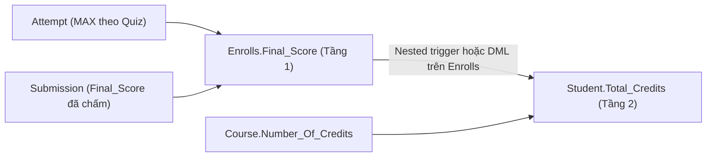
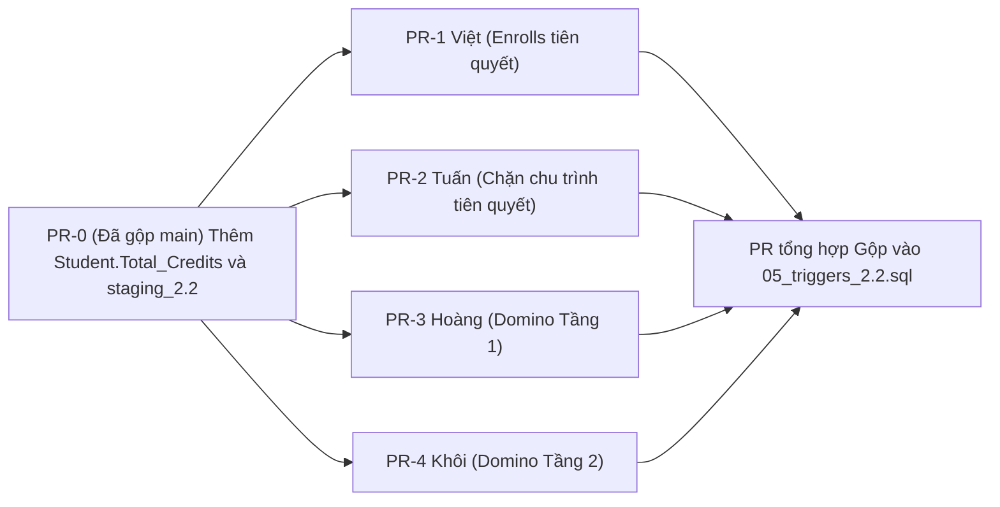

# Bức tranh toàn cảnh mục 2.2 (Triggers)

Tài liệu này giúp cả 4 thành viên hiểu rõ bức tranh chung của phần 2.2 trước khi tách nhánh làm việc, biết rõ trigger của mình nối vào đâu trong hệ thống và tránh xung đột mã nguồn khi gộp vào `05_triggers_2.2.sql`.

## 1. Bức tranh toàn cảnh mục 2.2

Đề bài phần 2.2 gồm hai yêu cầu nghiệp vụ độc lập nhau về mục đích nhưng cùng vận hành trên lược đồ `bk_db_ass2` để giữ dữ liệu đào tạo luôn nhất quán.

1. **Mục 2.2.1 (Chặn dữ liệu sai cho môn tiên quyết)** bảo vệ đồ thị môn tiên quyết và điều kiện đăng ký học phần. Không sinh viên nào đăng ký được môn sau khi chưa đậu (`Final_Score > 4.00`) đủ các môn tiên quyết ở kỳ trước, không thao tác hạ điểm hoặc xóa kết quả đậu nào làm vi phạm môn sau đã đăng ký, và không ai chèn hay sửa được quan hệ tiên quyết tạo vòng lặp kiểu A qua B rồi quay về A.
2. **Mục 2.2.2 (Tự động tính điểm và tín chỉ theo hiệu ứng Domino)** tự động lan truyền điểm mới qua hai tầng tính toán mà không giả sử dữ liệu trung gian đã có sẵn.
   - **Tầng 1 (tính `Enrolls.Final_Score` từ dữ liệu thô)** gom điểm cao nhất của từng bài Quiz trong `Attempt` cùng điểm các bài Assignment đã chấm trong `Submission` để cập nhật lại điểm tổng kết học phần `Enrolls.Final_Score`.
   - **Tầng 2 (tính `Student.Total_Credits` từ `Enrolls` và `Course`)** phản ứng ngay khi `Enrolls.Final_Score` vừa thay đổi hoặc khi `Course.Number_Of_Credits` thay đổi, cộng dồn số tín chỉ các môn đã đậu (`Final_Score > 4.00`, không cộng trùng môn học lại) vào cột `Student.Total_Credits`.

### Luồng dữ liệu Domino 2 tầng

### Luồng triển khai 6 PR không xung đột

Nền móng `PR-0` (`03_alter_student_total_credits.sql` và thư mục `staging_2.2/`) đã được gộp sẵn lên `main` để cả 4 thành viên có sẵn cột `Student.Total_Credits` trước khi viết trigger. Từ `main`, mỗi người tách một nhánh riêng, sửa đúng một cặp tệp `.sql` và `.md` mang tên mình, sau đó gộp tất cả thành một tệp `05_triggers_2.2.sql` duy nhất ở thư mục gốc.

## 2. Phân công vai trò chi tiết cho 4 thành viên

Mỗi thành viên nhận đúng cụm bảng sở trường từ giai đoạn 1.1 để không mất thời gian làm quen lại khóa chính và khóa ngoại, đồng thời giữ khối lượng và độ khó cân bằng.

| Thành viên | Cặp tệp trong `staging_2.2/` | Nhánh đề xuất | Mục | DML xử lý | Trách nhiệm cốt lõi | Lý do phân công từ 1.1 |
| --- | --- | --- | --- | --- | --- | --- |
| Việt | `trg_Enrolls_CheckPrerequisite_Viet.sql` và `.md` | `2.2/prereq-enrolls-viet` | 2.2.1 | `INSERT`, `UPDATE`, `DELETE` trên `Enrolls` | Chặn đăng ký học phần nếu thiếu môn tiên quyết đạt `> 4.00` ở kỳ nhỏ hơn, đồng thời chặn hạ điểm hoặc xóa dòng đậu làm gãy đăng ký môn sau | Từng thiết kế cụm bảng `Enrolls` và `Is_Prerequisite_To` |
| Tuấn | `trg_IsPrerequisiteTo_NoCycle_Tuan.sql` và `.md` | `2.2/nocycle-prereq-tuan` | 2.2.1 | `INSERT`, `UPDATE` trên `Is_Prerequisite_To` | Dùng `Recursive CTE` chặn mọi vòng lặp tiên quyết trực tiếp hoặc gián tiếp và chặn môn tự làm tiên quyết cho chính nó | Từng xử lý kiểm thử toàn vẹn, viết thêm ca kiểm thử tổng hợp cho 2.2 |
| Hoàng | `trg_Domino_EnrollFinalScore_Hoang.sql` và `.md` | `2.2/domino-enroll-score-hoang` | 2.2.2 (Tầng 1) | `INSERT`, `UPDATE`, `DELETE` trên `Attempt` và `Submission` | Lấy `MAX` điểm từng Quiz kết hợp điểm Assignment đã chấm để cập nhật `Enrolls.Final_Score` | Từng thiết kế `Attempt` và `Submission` ở 1.1 và 2.1 |
| Khôi | `trg_Student_UpdateTotalCredits_Khoi.sql` và `.md` | `2.2/domino-total-credits-khoi` | 2.2.2 (Tầng 2) | `INSERT`, `UPDATE`, `DELETE` trên `Enrolls` và `UPDATE` trên `Course` | Cộng dồn tín chỉ các môn có `Final_Score > 4.00` vào `Student.Total_Credits`, chỉ tính mỗi mã môn một lần | Từng thiết kế bảng `Student` ở Issue 1 |

## 3. Tương tác với 4 thủ tục 2.1 và mốc dữ liệu nền

### Tương tác với `04_procedures_2.1.sql`

Bốn thủ tục ở `04_procedures_2.1.sql` đều thao tác trên bảng `Submission` nên khi `05_triggers_2.2.sql` được nạp cùng lúc, mọi lời gọi thủ tục đều đi qua trigger `Submission` thuộc phần 2.2.2 Tầng 1.

- `sp_InsertSubmission` chèn bản ghi mới với `Final_Score = NULL`, nên trigger cần thoát nhánh cập nhật điểm sớm khi dòng chèn chưa có điểm.
- `sp_UpdateSubmission` chỉ sửa `Title` và `Submit_Time`, nên trigger cần dùng `UPDATE(Final_Score)` để thoát sớm khi cột điểm không thay đổi.
- `sp_DeleteSubmission` chỉ cho phép xóa bài nộp có `Final_Score IS NULL`, nên trigger thấy `DELETED.Final_Score IS NULL` sẽ thoát sớm.
- `sp_GradeSubmission` gán giá trị thực vào `Submission.Final_Score`, trực tiếp kích hoạt trọn chuỗi Domino từ `Submission` sang `Enrolls.Final_Score` và nối tiếp sang `Student.Total_Credits`. Nhóm sẽ kiểm thử tích hợp kịch bản này khi gộp `05_triggers_2.2.sql`.

### Mốc dữ liệu nền từ `03_alter_student_total_credits.sql`

Sau khi chạy `reset_db.bat`, tập dữ liệu mẫu `02_seed_data_1.2.sql` đi qua bước backfill của `03_alter_student_total_credits.sql` sẽ tạo sẵn giá trị `Total_Credits` chuẩn cho 10 sinh viên để Khôi và các thành viên khác đối chiếu khi test. Lưu ý sinh viên `ID = 11` (`SV5`) học lại `CO1005` vẫn chỉ được tính tín chỉ một lần và môn `MT1003` đúng `4.00` điểm chưa được tính là đậu (`Final_Score > 4.00`).

| `Student.ID` | Mã SV | `Total_Credits` sau `03` |
| --- | --- | --- |
| 7 | SV1 | 25 |
| 8 | SV2 | 17 |
| 9 | SV3 | 14 |
| 10 | SV4 | 18 |
| 11 | SV5 | 14 |
| 12 | SV6 | 18 |
| 13 | SV7 | 14 |
| 14 | SV8 | 4 |
| 15 | SV9 | 14 |
| 16 | SV10 | 0 |

## 4. Checklist kỹ thuật T-SQL và quy trình làm việc

1. **Dựng môi trường sạch trước khi code** bằng lệnh `.\reset_db.bat` ở thư mục gốc để có đủ lược đồ `01`, dữ liệu mẫu `02`, cột `Student.Total_Credits` ở `03` và các thủ tục `04`.
2. **Xử lý theo tập hợp (set-based)** trên toàn bộ bảng ảo `INSERTED` và `DELETED`, tuyệt đối không viết `SELECT @var = ... FROM inserted` vì sẽ sai khi câu lệnh tác động nhiều dòng cùng lúc.
3. **Thoát sớm an toàn** với `SET NOCOUNT ON;` và kiểm tra `IF @@ROWCOUNT = 0 RETURN;` ngay đầu trigger để tránh làm nhiễu số dòng trả về hoặc chạy truy vấn dư thừa.
4. **Kiểm tra lồng nhau và vòng lặp** bằng cách đảm bảo trigger trên `Enrolls` (cập nhật `Student.Total_Credits`) không ghi ngược lại bảng `Course` hoặc `Submission`, và bật lưu ý `NESTED_TRIGGERS` mặc định trên SQL Server đang hoạt động ổn định.
5. **Chỉ sửa đúng cặp tệp của mình** trong `staging_2.2/` (`*.sql` chứa lệnh `CREATE OR ALTER TRIGGER`, `*.md` ghi rõ phân tích DML, ca test dương tính, ca test âm tính và kết quả chạy thực tế), tuyệt đối không chỉnh sửa tệp gốc `01` đến `05` hoặc tệp của thành viên khác khi làm PR cá nhân.
